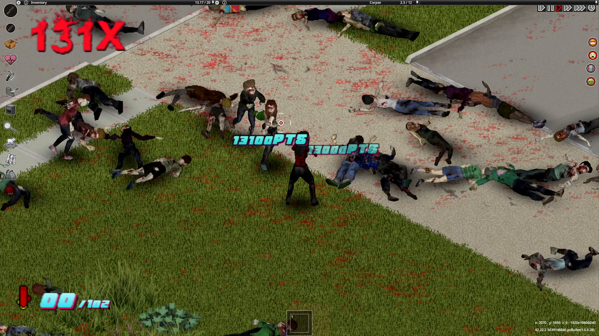
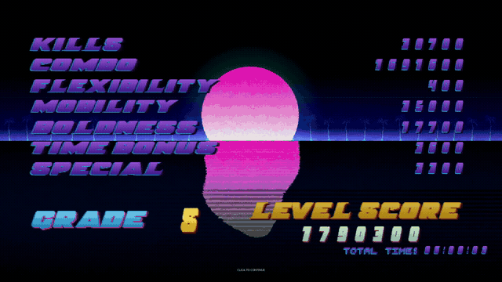
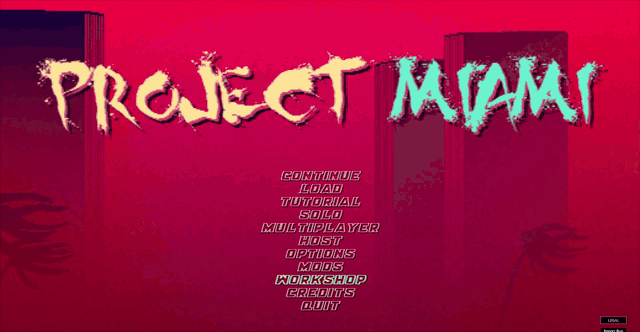
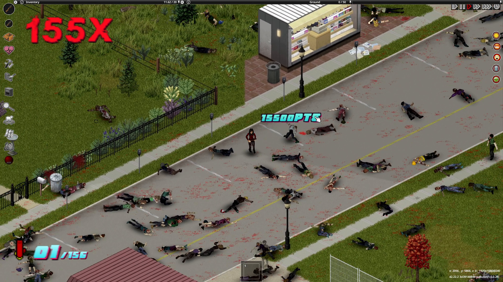

# Project Miami

*Formerly Neon Death Grade.*

A personal Project Zomboid Build 42 mod inspired by arcade-style scoring systems and Hotline Miami.

The mod adds a combo system, a custom death screen with scoring categories and grades, a weapon HUD, a dynamic soundtrack and a restyled main menu.

Available on the Steam Workshop: [Project Miami [B42]](https://steamcommunity.com/sharedfiles/filedetails/?id=3842895126)

## Demo

Short gameplay clip showing the player death and transition to the custom death screen:

[Watch demo video](docs/DeathScreenDemo.mp4)

## Features

- Combo counter: kills within 6 seconds of each other build a chain
- Point popups above every killed zombie, combo bonus included
- Animated death screen with seven scoring categories (Kills, Combo, Flexibility, Mobility, Boldness, Time Bonus, Special) and a grade from F to S
- Death screen can be skipped and closed with the mouse, keyboard or a controller
- Weapon HUD with loaded rounds, reserve ammo and a chambered round indicator
- Dynamic soundtrack: calm and combat playlists, a horde track, themes for map landmarks, wake-up and loading music
- Animated Hotline Miami 2-style main menu

## Installation

Subscribe on the Steam Workshop to get the full mod. Build 42 only.

This repository contains the code and art but not the soundtrack: the music files belong to their artists and are not stored here. Without them the mod still runs, only the music is silent.

## My role

This was a personal AI-assisted modding project.

My role included:

- designing the concept and gameplay requirements
- defining how the scoring and grade systems should work
- designing UI behavior and layout
- testing implementations in-game
- identifying bugs and gameplay issues
- iterating on mechanics and presentation
- adjusting balance values and scoring rules

The technical implementation was created with extensive AI assistance.

## Tech

- Lua
- Project Zomboid Build 42
- AI-assisted development

## Status

Released on the Steam Workshop. Work in progress.

## Credits

Inspired by Hotline Miami and Hotline Miami 2: Wrong Number by Dennaton Games / Devolver Digital. Music, fonts and sprites from those games belong to their respective owners. Non-commercial fan project.
